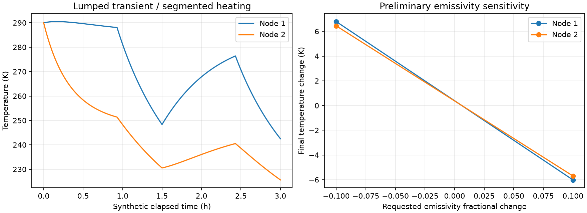

# Satellite Thermal Model Lab

Spacecraft subsystem designers and students need preliminary thermal trade studies with auditable energy balances. This Python/SciPy model simulates one to six lumped nodes, symmetric conductive links, radiative loss to an effective blackbody background, internal power and synthetic periodic sunlit/eclipse absorbed heating. It generates reproducible transient/sensitivity plots and numerical verification reports.

## Model and architecture

For each node, C_i dT_i/dt = Q_i(t) + Σ G_ij(T_j−T_i) + ε_i A_i σ(T_env^4−T_i^4). SI units: J/K, W/K, W, m², K and seconds. σ=5.670374419×10^-8 W m^-2 K^-4. Absorbed sunlit/eclipse powers are user-supplied hypothetical values; no ephemeris, Earth view-factor or geometry calculation is implied. Uniform node temperatures, constant properties, vacuum and no inter-node radiation are assumed.

Validated input → RK45 integration split at every heating discontinuity → dense-output sampling → independent adaptive flux quadrature/energy balance → tighter step/tolerance comparison → emissivity trade cases → JSON/Markdown/PNG. Reference tests include exact linear heating, isolated conductive relaxation, pure radiative cooling and radiative equilibrium.

## Requirements and usage

Python 3.12; NumPy, SciPy, Matplotlib in a project-local environment.

```sh
python3 -m venv .venv
.venv/bin/pip install -r requirements.lock
OPENBLAS_NUM_THREADS=2 MPLBACKEND=Agg .venv/bin/python -m unittest discover -s tests -v
OPENBLAS_NUM_THREADS=2 MPLBACKEND=Agg .venv/bin/python src/thermal.py examples/satellite.json results
```

The two-node fixture runs two synthetic 5400 s orbits with 62% sunlight. Reports expose final temperatures, energy residual, solver evaluations and max difference against refined settings. Acceptance: relative energy residual <10^-5 and temperature difference <0.001 K. Emissivity ±10% studies record actual values clipped to [0,1].

## Limits, resource bounds and portfolio value

No validated digital twin, physical spacecraft correspondence, flight qualification, geometry-dependent radiation, temperature-dependent properties, active thermal control or material uncertainty calibration. Parameter sensitivity is not a mission uncertainty bound. Numerical convergence does not prove physical validity. Maximum six nodes, 21600 s, 1000 output samples and 200000 RHS evaluations; conductance/capacity ratio bounded and temperatures outside (0,1000] K reject. CLI config limit 64 KiB, CPU only with two numerical-library threads in documented execution. Original small model provides explicit analytical and energy checks instead of unsupported aerospace claims.



## Verification and publication

Evidence labels: VERIFIED = checked against a stated criterion; OBSERVED = measured execution; INFERRED = interpretation; HYPOTHESIS = proposed explanation; NOT_VERIFIED = missing evidence. Local status and executed commands are in `results/validation.json` and `docs/REVIEW.md`. Synthetic validation establishes implementation behavior, not production accuracy.

This is an independent Git repository with original MIT project code. Publication-gate evidence is in `results/publication-gate-20261012.json` and `docs/PUBLICATION_REVIEW.md`. The original local-delivery records are retained as historical evidence. CI uses public dependency registries and requires no secrets. See `docs/PROVENANCE.md` for dependency and advisory review scope.

## License

MIT; see LICENSE.

Verification scope: flux quadrature applies an independent integration method to the same solver dense trajectory; it is a consistency check, not independent dynamics or experimental evidence. Refinement is checked at reported sample times for the base case. Sensitivity cases are preliminary and do not each undergo the base refinement gate. The plot axis shows requested emissivity changes; reports retain actual clipped values.

## Reproducing development checks

Optional public-registry dependency review: `python3 tools/dependency_audit.py .` writes `results/dependency-audit.json`. This developer check uses the free OSV API and is separate from offline application execution. Zero listed advisories does not prove absence of vulnerabilities. License evidence is in results/licenses.json and, for scientific projects, results/python-licenses.json.

Install `requirements-dev.txt` to run the recorded Ruff 0.17.0 source checks. Commands, actual versions, failed attempts, review corrections and measured peak RSS are retained in results/validation.json, results/tool-versions.json and docs/REVIEW.md. Check the GitHub Actions run for the exact commit before claiming hosted CI success; older local-delivery records retain their as-of NOT_VERIFIED status.
